# Punto de Venta Dolores: TDD

## 1. Producto

Rojo: la prueba falla porque la clase `Producto` todavía no existe.

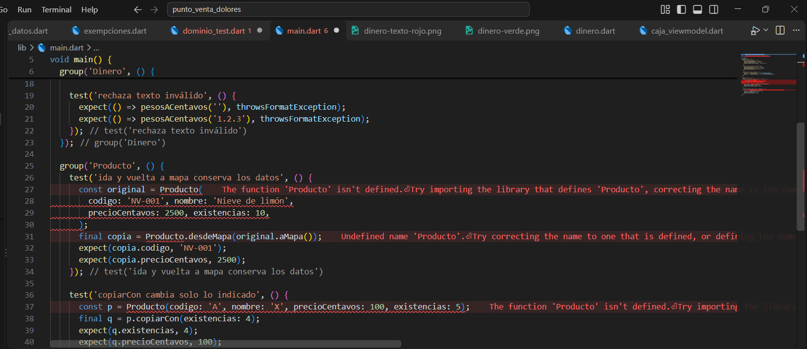

Verde: se crea `Producto` y la prueba pasa.

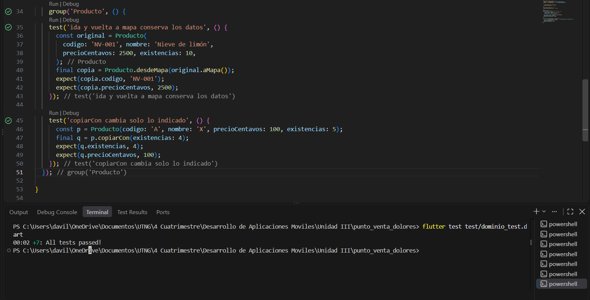

---

## 2. Dinero

Rojo: la prueba falla porque `Dinero` todavía no existe.

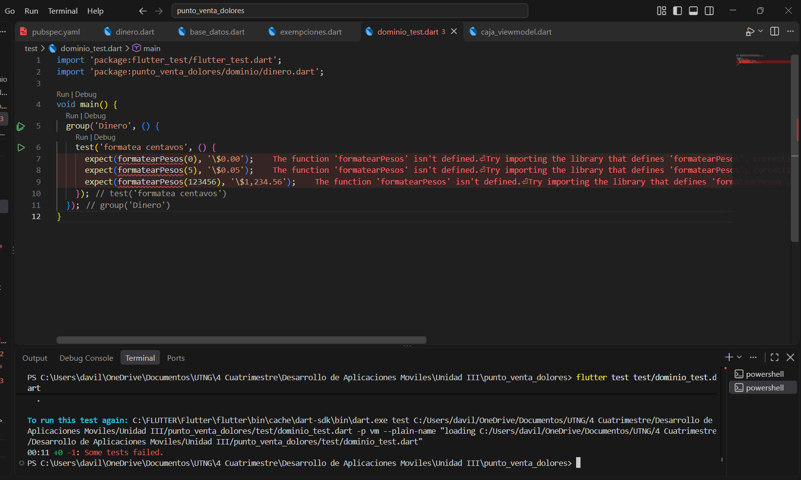

Verde: se implementa `Dinero` y la prueba pasa.

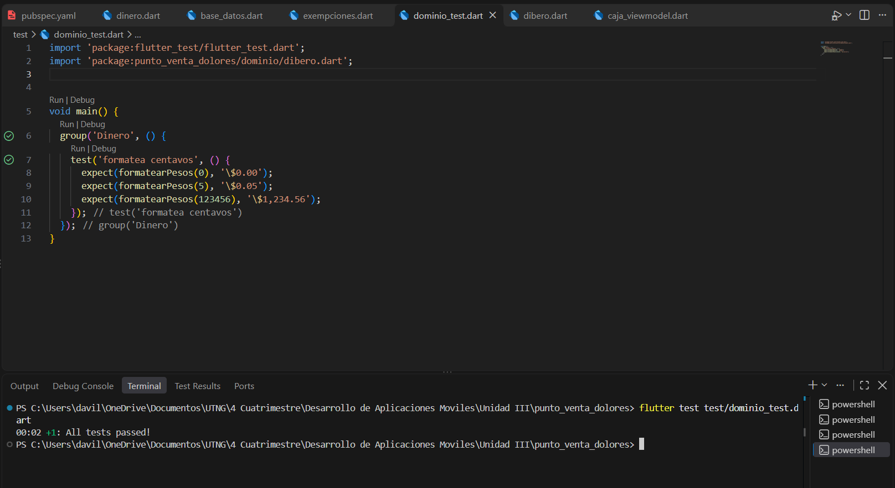

### Dinero como texto

Rojo: la prueba del formato de texto falla.

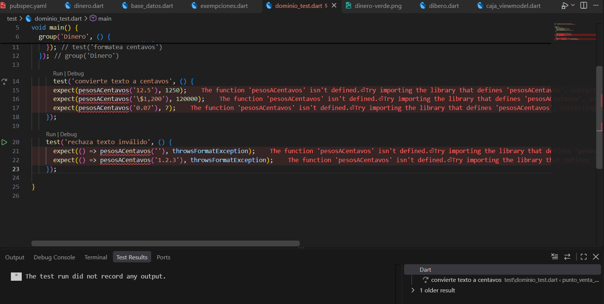

Verde: se implementa la representación en texto y la prueba pasa.

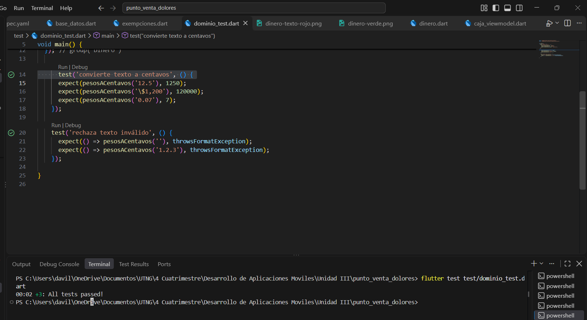

### Reto

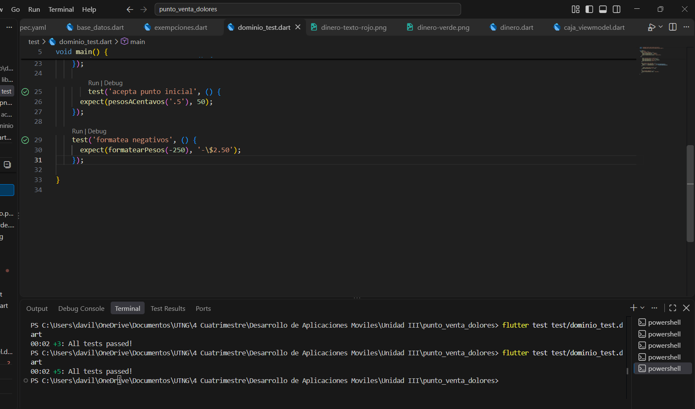

---

## 3. Carrito

Rojo: la prueba falla porque `Carrito` todavía no existe.

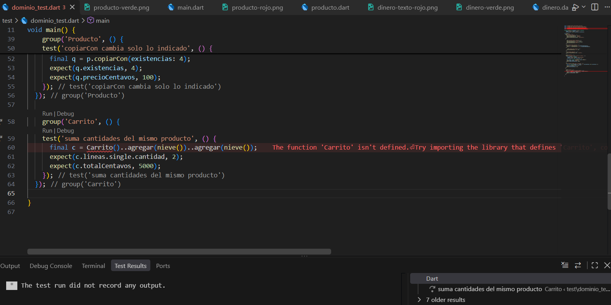

Verde: se implementa `Carrito` y la prueba pasa.

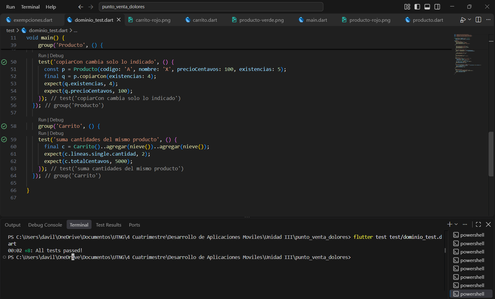

### IVA

Rojo: la prueba del cálculo de IVA falla.

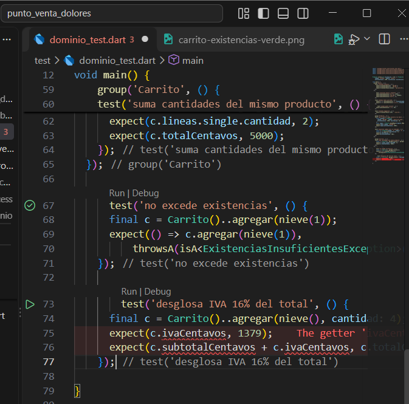

Verde: se implementa el cálculo de IVA y la prueba pasa.

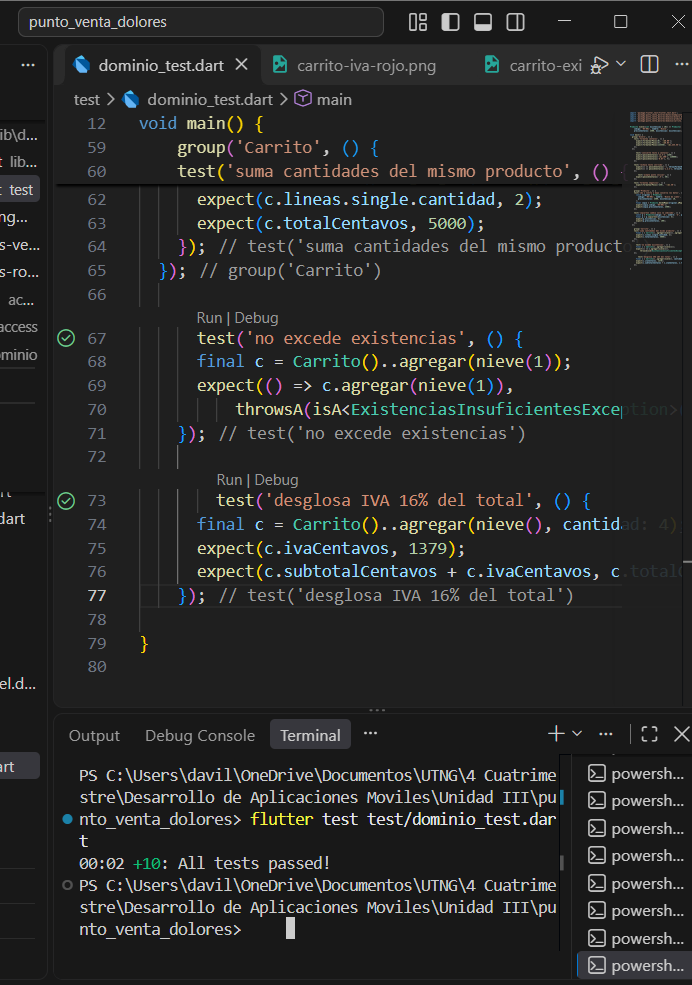

### Existencias

Rojo: la prueba de control de existencias falla.

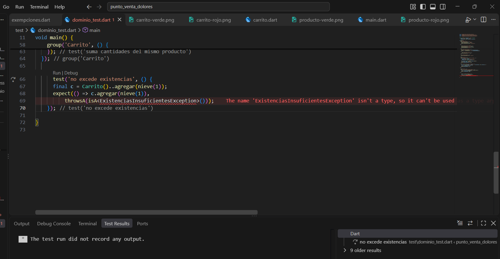

Verde: se implementa el control de existencias y la prueba pasa.

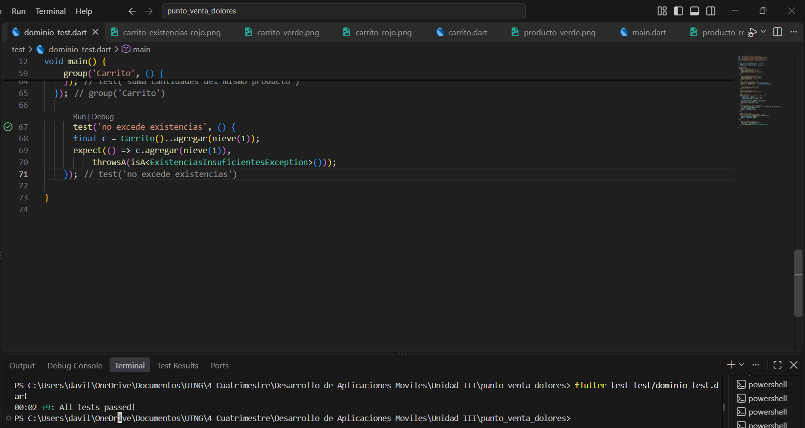

